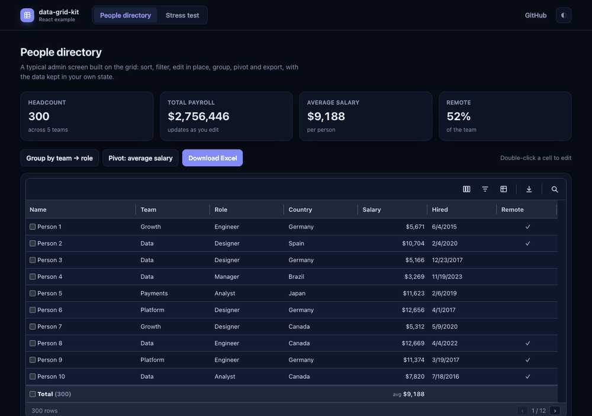
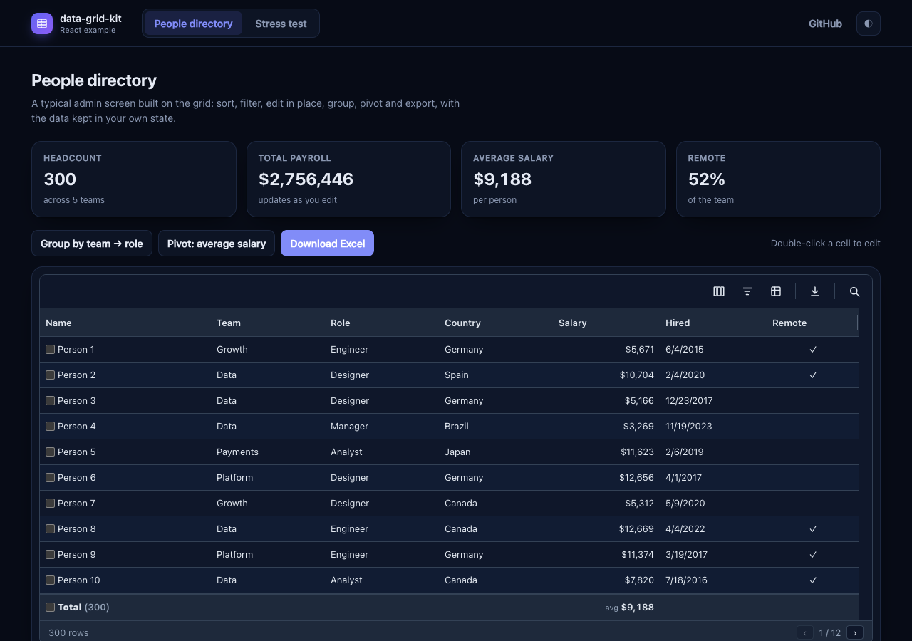
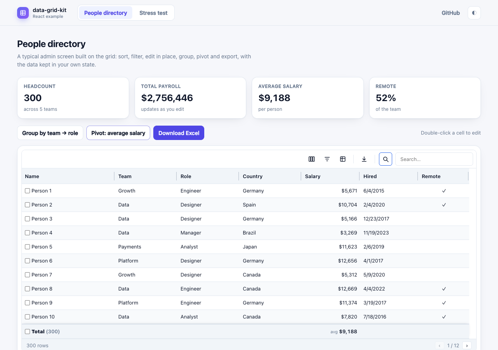

<div align="center">

# data-grid-kit

**A headless-first, high-performance data grid for React.**
Virtualized, accessible and fully customizable: use the ready-made `Grid`, restyle it, replace any part of it, or build your own markup on the same core.

[](https://github.com/GabrielGomesBarbosa/data-grid-kit/actions/workflows/ci.yml)
[](LICENSE)


[Documentation and live demos](https://gabrielgomesbarbosa.github.io/data-grid-kit/) ·
[Quick start](#quick-start) ·
[Features](#features) ·
[Roadmap](https://github.com/GabrielGomesBarbosa/data-grid-kit/milestones)

<br />



</div>

<br />

## Introduction

Teams that maintain a design system usually end up wrapping someone else's table, or writing one from scratch. Both are expensive: a grid that is
correct (virtualization, keyboard navigation, ARIA, editing, grouping, export) is a large amount of work, and a grid that cannot be restyled or
rearranged never quite fits the product.

data-grid-kit separates the two concerns:

- **A headless core** (`data-grid-kit/core`): a store, an incremental row pipeline (sort, filter, group, aggregate, pivot), layout math and the
  `useGrid` hook. No markup, no CSS, no UI-library dependency.
- **A ready-made UI** (`data-grid-kit`): a virtualized, accessible `Grid` built on that core. Every visible part is a *slot* you can replace, every
  element is reachable through prop getters, and the stylesheet is optional.

It is built for large data: rows and columns are virtualized, edits and live updates are applied incrementally instead of rebuilding the table, and
the pipeline is tested against a full rebuild with randomized inputs.

The feature set and the documentation take inspiration from established data grids, notably MUI X Data Grid. data-grid-kit is an independent
implementation by its own author: it shares no code with those projects and has no UI-library dependency.

## Highlights

- **Fast at scale.** Row and column virtualization, incremental updates, sort keys computed once. 100,000 rows: a sorted flat list in about 18 ms, two-level grouping with aggregation in about 50 ms.
- **Customizable by design.** Slots, `slotProps`, prop getters, an unstyled mode and CSS variables. Bring your own buttons, inputs and icons.
- **Accessible.** ARIA grid roles, full keyboard navigation, screen-reader announcements and automated axe checks in CI.
- **Complete.** Sorting, filtering, editing, selection, pinning, reordering, tree data, grouping, aggregation, pivoting, server-side data, clipboard, CSV and Excel export.
- **Localizable.** Every text can be replaced; numbers and dates follow the locale you choose. A Brazilian Portuguese pack is included.
- **Framework friendly.** ESM and CommonJS, server rendering, Next.js App Router ready, React 18+.

## Quick start

> data-grid-kit is in pre-release (0.x) and is not on npm yet. Until the first release, build it from this repository (see [Development](#development)) and install the generated package.

```tsx
import { Grid, type UIColumnDef } from 'data-grid-kit'
import 'data-grid-kit/styles.css'

interface Person {
  id: number
  name: string
  age: number
}

const columns: UIColumnDef<Person>[] = [
  { field: 'name', headerName: 'Name', width: 200, editable: true },
  { field: 'age', headerName: 'Age', type: 'number' },
]

export function People({ rows }: { rows: Person[] }) {
  return <Grid rows={rows} columns={columns} getRowId={(r) => r.id} height={400} toolbar />
}
```

Headless, with your own markup driven by the core:

```tsx
import { useGrid } from 'data-grid-kit/core'

const grid = useGrid({ rows, columns, getRowId: (r) => r.id })
// grid.rows, grid.layout, grid.state, grid.api.toggleSort('name'), ...
```

In Next.js, import the grid from a file marked `"use client"`. The [`next-example`](apps/next-example) app shows server rendering and server-side data.

## Features

| Area | What you get |
|---|---|
| **Basics** | Multi-column sorting, typed filtering (filter panel and quick filter), pagination, row selection, in-place editing with validation, column menu, columns panel, toolbar, resize, hide and show |
| **Scale** | Row and column virtualization, variable and content-sized row heights, incremental live updates (insert, edit and remove without a rebuild) |
| **Layout** | Column pinning, row pinning, column reordering by drag, column groups, detail panels, row reordering |
| **Hierarchy** | Tree data, row grouping, aggregation (sum, avg, min, max, count, size, custom), pivoting with nested column groups and a docked pivot panel |
| **Spreadsheet-like** | Cell range selection, clipboard (copy, cut, paste), fill handle |
| **Server-side data** | `dataSource.getRows` with lazy loading, block cache, request cancellation, retry, infinite scroll, server trees |
| **Export** | CSV and a dependency-free **.xlsx** writer (typed cells, number formats, merged column groups, outline levels) that can run in a web worker |
| **Customization** | Slots, `slotProps`, prop getters, unstyled mode, CSS variables, toolbar parts you can recompose |
| **Localization** | `localeText` for every fixed text, `locale` for numbers and dates, language packs in `data-grid-kit/locales` |
| **Events** | Row, cell and header click and key events, with `preventDefault()` to stop the grid's own reaction |

Every feature has a documented status and its known limits on the [feature status page](https://gabrielgomesbarbosa.github.io/data-grid-kit/#/features). What is planned next lives in the [milestones](https://github.com/GabrielGomesBarbosa/data-grid-kit/milestones).

## Customization

The grid is meant to behave like an unstyled component library: your look, your markup where you need it, the behaviour and speed underneath.

- **Restyle** with the optional stylesheet's CSS variables, or import only `structure.css` (layout the grid needs to work) and write the theme yourself.
- **Replace parts** with `slots` (toolbar, footer, rows, cells, popovers, panels, icons, base button / input / select) and tune them with `slotProps`.
- **Draw it yourself** with `useGridView`, which returns the prepared rows plus prop getters for the root, scroller and body, so virtualization, keyboard navigation and ARIA stay.
- **Go fully headless** with `data-grid-kit/core` and render anything.

## Localization

```tsx
import { Grid } from 'data-grid-kit'
import { ptBR } from 'data-grid-kit/locales'

<Grid rows={rows} columns={columns} {...ptBR} />                          // a language pack: texts and locale
<Grid rows={rows} columns={columns} locale="de-DE" localeText={myTexts} /> // your own keys; the rest stays in English
```

Keys are strings, or functions when a text has a name or a number in it, so react-intl and next-intl fit as they are.

## Performance

Measured in Node (`npm run bench`), 100,000 rows: build a sorted flat list ≈ 18 ms, group by two columns with aggregation ≈ 50 ms, pivot ≈ 35 ms, edit one value in a live grid ≈ 0.3 ms. The documentation includes a benchmark you can run in your own browser.

## Examples

<table>
  <tr>
    <td width="50%"></td>
    <td width="50%"></td>
  </tr>
</table>

| | |
|---|---|
| [Documentation site](https://gabrielgomesbarbosa.github.io/data-grid-kit/) | Introduction, live demos with their source, API tables, feature status, benchmarks |
| [`apps/react-example`](apps/react-example) | A Vite + React app using the library like a consumer would: a people directory and a 500,000-row stress test |
| [`apps/next-example`](apps/next-example) | A Next.js App Router app with server rendering and server-side data through a Route Handler |

## Repository

| Path | What it is |
|---|---|
| [`packages/data-grid-kit`](packages/data-grid-kit) | The library, published to npm. Its README is the npm page |
| `packages/sample-data` | Deterministic fake data shared by the docs and the examples (private) |
| [`apps/docs`](apps/docs) | The documentation site |
| [`apps/react-example`](apps/react-example), [`apps/next-example`](apps/next-example) | Example applications |
| `tools/media` | Scripts that record the demo animation and screenshots used in this README |

It is a [Turborepo](https://turbo.build) with npm workspaces.

## Development

Requires Node 20 or newer.

```bash
npm install
npm run dev                        # documentation site, hot reload of the library source → http://localhost:5300
npm run dev -w react-example       # React example → http://localhost:5400
npm run build && npm run dev -w next-example   # Next.js example → http://localhost:5500
```

| Command | What it does |
|---|---|
| `npm run build` | Build the library, the docs and both examples, in dependency order (cached) |
| `npm run typecheck` | TypeScript across all workspaces |
| `npm test` | Unit and randomized tests (incremental updates are fuzzed against a full rebuild) |
| `npm run check` | Typecheck, test, build, lint and package checks: what CI runs |
| `npm run bench` | Node benchmarks of the library |

## Contributing

Issues and ideas are welcome. Every change to the library is expected to keep the tests green and to add or update tests together with the code. See [CONTRIBUTING.md](CONTRIBUTING.md) and the [code of conduct](CODE_OF_CONDUCT.md).

## Status

Pre-release (0.x): the API can still change between minor versions. Releases and notes are on the [releases page](https://github.com/GabrielGomesBarbosa/data-grid-kit/releases).

## License

[MIT](LICENSE) © Gabriel Gomes Barbosa.
